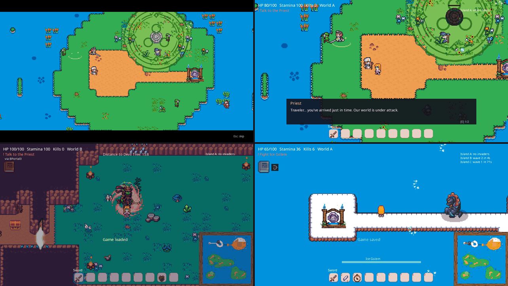

#  Pocket2D

Pocket2D is a cross-platform 2D runtime + editor game engine, written in C++26 on top of
SDL3, Lua, Box2D 3, Dear ImGui, and JSON scene assets. It hosts Lua for game logic scripting.
It is a variant of the [A2 Engine](https://a2engine.org/). For basic usage, check the documentation of A2 engine for the APIs.

Pocket2D Lua API documentation lives here:
- local source: [docs/lua-api/index.md](docs/lua-api/index.md)
- GitHub Pages: https://qiulinfan.github.io/pocket2d/

> Below is a demo of the editor and runtime in action, running the example
> "ball game" included in `.engine/templates/ballgame/`. This example game originates from the
> [A2 Engine](https://a2engine.org/) ecosystem.


The game has a Unity-like editor layout and runtime integration with:
- `SceneView` panel with actor-picking and drag&drop editing;
- embedded `Viewport` panel for pure runtime output;
- `Project` browser rooted at the currently opened project folder with scene opening and asset drag&drop support;
- `Hierarchy` tree with create, duplicate, delete, rename, actor reparenting;
- `Inspector` for component add/remove/rename and property editing
- actor parenting with local/world `Transform` and physics hierarchy inspection
- play-mode live editing and automatic scene-backed actor UID persistence
- `Sprite Editor` for creating and editing sprite assets.

## Games built with Pocket2D

Two complete games test how much of a real game the engine supports. Each is
played end to end by scripted playtests through the agent protocol, and every
engine gap they exposed was fixed in the engine
([game completeness tests](docs/development/game-completeness-tests.md)).

**Village Rim** is a migration of the Unity 6 game Village_Rim onto Pocket2D.
`pocket import unity` brings in its world: 65 tilemaps and 54,000 tiles,
sprites, colliders and spawn points. Its gameplay is rewritten in Lua:
- the opening cutscene, played frame by frame from the Unity Timeline;
- the quest line with NPC dialogue and side quests;
- two worlds joined by portals, and an island route through world B's locked
  rooms with keys, chests and doors;
- elemental altars, invasions, devil trees, tree planting and field farming;
- world B's enemies, four bosses, the Ice Golem and the final High Priest;
- the active shield's parry and reflection, and saves and checkpoints;
- the credits and the spring thaw.

Its playtests walk the whole route from the opening to the ending with real
input (22 checks, identical on repeat runs) and exercise each system (32 checks).



**PocketTerraria** is a Terraria-like sandbox written from scratch on the
engine. It has a seeded world with caves and ores, mining, building and tree
felling, light that spreads through tiles, day and night, crafting, slimes, and
the two-phase Eye of Cthulhu. It is being extended toward Terraria's full
progression.

Both games live in a separate private repository, since their art is not
redistributable.

## Build
### Linux Release
Install:
```bash
git clone https://github.com/qiulinfan/pocket2d.git
```

Build:
```bash
cd pocket2d
cmake --preset unix-makefiles-release
cmake --build --preset unix-makefiles-release -j4
```

Run the editor from the repository root:
```bash
./build/unix-makefiles-release/pocket
```

Run the game executable:
```bash
./build/unix-makefiles-release/game
```

### Windows Release
Requires:
- Visual Studio 2022 with `Desktop development with C++`

Download the source from GitHub and extract it. Then open PowerShell in the extracted `pocket2d` folder.

Build:

```powershell
cmake --preset vs2022-x64
cmake --build --preset vs-release
```

Run the editor:

```powershell
.\build\vs2022-x64\Release\pocket.exe
```

Run the game executable:

```powershell
.\build\vs2022-x64\Release\game.exe
```

## Repository Layout and Architecture

- `src/app/runtime`, `src/app/editor`: executable hosts
- `src/engine/*`: runtime systems
- `src/editor/*`: editor shell, documents, panels
- `src/shared/*`: config, scene format, resource helpers
- each `src/` folder keeps its headers beside its sources
- `.engine/system/*`: editor fonts and icons
- `.engine/templates/*`: project templates, including the ball game sample
- `thirdparty/*`: vendored dependencies; SDL3 (with SDL_image, SDL_ttf, SDL_mixer) and Box2D 3 are fetched at configure time
- `api/*`: Lua host API contract, agent command schema, asset JSON Schemas, and the Lua and TypeScript declarations generated from the contract (`api/types/`)
- `clients/python/*`, `tools/*`: the Python agent client and the `pocket` command line
- `tests/*`: CTest suites and fixture projects

## Projects
Projects can live anywhere on disk. Like Unity Hub, the editor keeps a per-user list of project paths in `projects.config`, next to `editor.config`, in `~/Library/Application Support/Pocket2D/` on macOS, `%APPDATA%\Pocket2D\` on Windows, and `$XDG_CONFIG_HOME/pocket2d/` (default `~/.config/pocket2d/`) on Linux. Nothing about your projects is stored in the engine folder. `File -> Open Project...` adds an existing project folder and `File -> Recent Projects` reopens one. The panel layout is saved there too, in `imgui.ini`; the first launch docks the panels as Unity does (Hierarchy left, Scene and Viewport center, Inspector right, Project and Status below), and `View -> Reset Layout` restores that arrangement. The editor starts in the Midnight theme with the system UI font (SF Pro on macOS, Segoe UI on Windows) at 17 px, and Chinese text falls back to Hiragino Sans GB on macOS (PingFang's outline format cannot be loaded), Microsoft YaHei on Windows or Noto Sans CJK on Linux. `Editor -> Editor Settings` switches the theme to Dark (Unity Professional) or Light (Unity Personal), the font to the bundled Inter and the text size between 12 and 24 px. The theme, the font, the text size and the Project browser's icon size (its slider) are saved in `editor.config` as soon as they change.

`File -> New Project...` asks for a template, a project name and a location, then copies the template into `<location>/<name>`. The location starts as your home folder and is remembered for the next project. Linux users type the location; Windows/macOS users can also pick it with the system folder picker. Templates are never edited in place:
- `Empty` creates `game.config`, `rendering.config`, `scenes/main.scene`, `actor_templates/empty.template`, and the standard project directories: `audio/`, `component_types/`, `fonts/`, `images/`, `scenes/`, and `actor_templates/`.
- `ballgame` copies the sample in `.engine/templates/ballgame/`.

When there is no project to reopen, as on first launch, the editor creates a `ballgame` project in the new-project location and opens it. The `game` runtime runs the project given by `--project`, else a packaged project beside it (see below), else the editor's current project, else the sample template.

A project can show a "Made with Pocket2D" splash before its first frame, as Unity games do: set `"splash_screen": true` (and optionally `"splash_seconds"`, 0.5 to 10, default 2) in `game.config`, or tick it in `Project -> Game Config`. Only the standalone `game` window shows it; the editor, `--frames` captures and headless agent runs skip it. The image is `.engine/system/splash.png`, drawn by `tools/make_splash.py` and compiled into the runtime.

Gameplay ticks 60 times a second (a fixed step keeps physics and replays deterministic), but the standalone `game` draws frames as fast as it can between ticks. To limit drawing, set `"max_fps"` (1 to 1000; 0, the default, is no limit) or `"vsync": true` in `game.config`, or in `Project -> Game Config`. A frame drawn between two ticks shows the camera, actor sprites and Lua draws given a key (the last argument of `Image.Draw`/`Image.DrawEx`) part of the way from the previous tick to the latest, so motion is smooth above 60 frames a second; the picture runs one tick behind. `"frame_interpolation": false` (or `Project -> Game Config`) shows the latest tick instead.

Press F3 in the standalone `game` window to show or hide its frame rate: frames per second, gameplay ticks per second, and the time the engine spends on a frame (average and worst over the last half second, not counting a frame limit or vsync wait). `"show_fps": true` in `game.config` (or `Project -> Game Config`) starts with it shown.

`pocket package PROJECT --platform mac|windows|linux|web` packages a project as a game players run without the engine: a macOS `.app`, a Windows or Linux folder, or a web page, each with a zip (a tar.gz for Linux). It needs a runtime kit for the platform, built once by `python3 tools/build_runtime.py PLATFORM` (on a macOS host for `mac`; in Docker for the others). Development files (`tools/`, `scenarios/`, `source_art/`, Markdown, hidden files and `game.config`'s `package_exclude` patterns) stay out. See [Packaging games](docs/development/packaging.md).

## Architecture Illustration

All files under `docs/architecture/` are diagram-only for explaining the architecture.
- [Frame Pipeline](docs/architecture/frame-pipeline.md)
- [Asset Pipeline](docs/architecture/asset-pipeline.md)
- [Module Dependency](docs/architecture/module-dependency.md)
- [Editor Workflow](docs/architecture/editor-workflow.md)

## Sample Project
`.engine/templates/ballgame/` contains the sample project, offered as the `ballgame` template.

## License

Pocket2D is released under the [MIT License](LICENSE).

Third-party libraries under `thirdparty/` keep their own upstream licenses.
